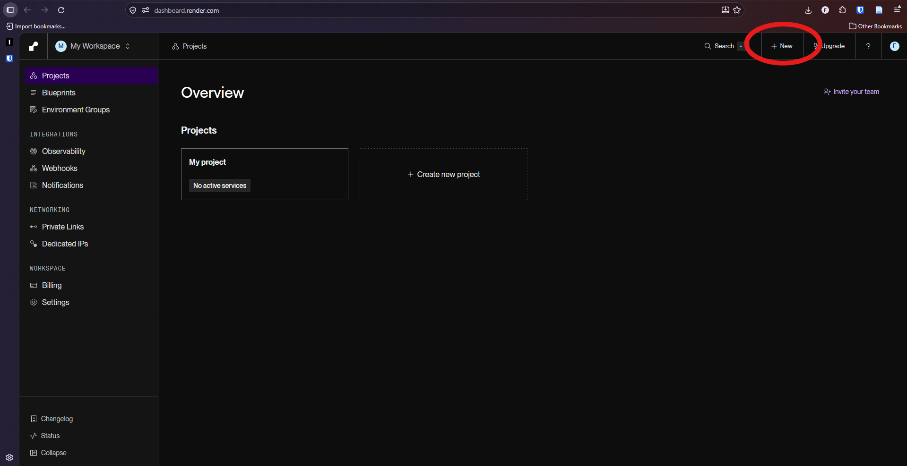
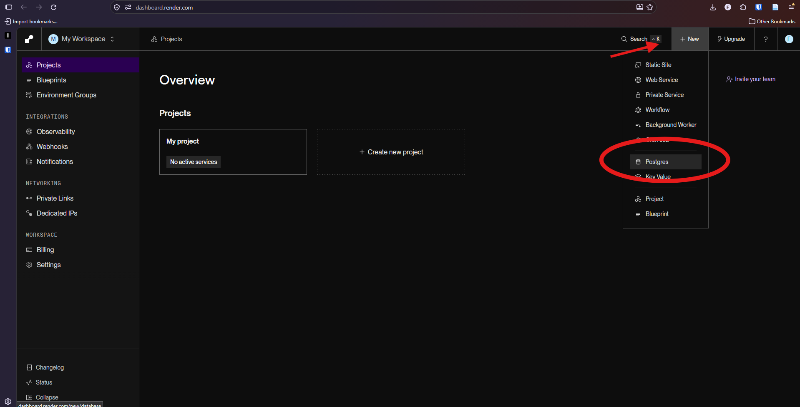
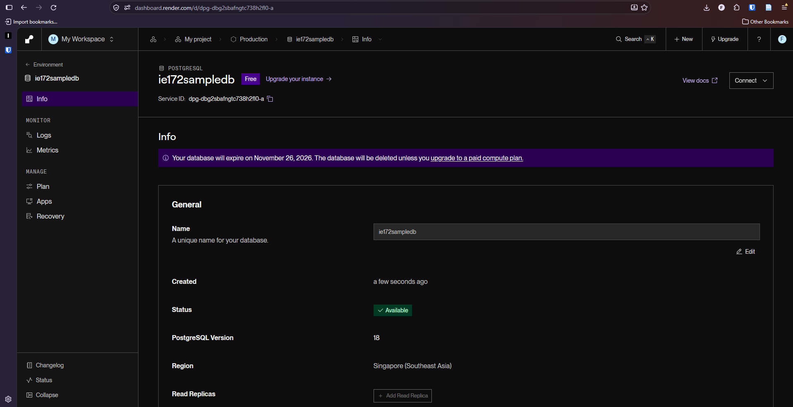
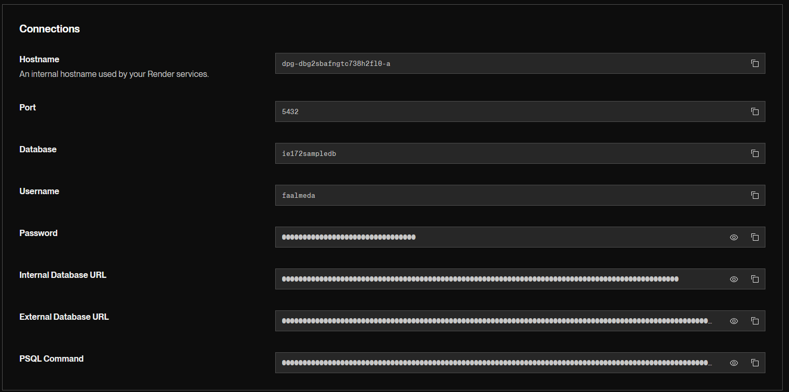

# Module 5b: App Deployment via Render


**NOTE: Only one group member per project should do submodules 5b and 5c.**

1. [Preliminaries](#1-preliminaries)
2. [Prepare your project](#2-prepare-your-project)
3. [Push your project to GitHub](#3-push-your-project-to-github)
4. [Create the database on Render](#4-create-the-database-on-render)
5. [Load your data into the Render database](#5-load-your-data-into-the-render-database)
6. [Create the web service](#6-create-the-web-service)
7. [Add your environment variables](#7-add-your-environment-variables)
8. [Deploy and test](#8-deploy-and-test)
9. [Managing the 30-day limit](#9-managing-the-30-day-limit)
10. [Updating your app or data](#10-updating-your-app-or-data)
11. [Troubleshooting](#11-troubleshooting)
12. [When you are done](#12-when-you-are-done)

## 1. Preliminaries

Web application deployment is another ordeal in its own. Creating your applications locally is easy to maintain, however if you want to share your work with a friend elsewhere, or if you want to access your website on your phone, you need to deploy your webiste and make it avaialble online given a specific URL.

So far your app has been talking to a PostgreSQL database running on your own computer (`localhost`). That database is invisible to the internet, so when your app is deployed online, it will not be able to reach it.

For this module, we will deploy both our backend and frontend using a service called **Render**. It is a Platform-as-a-Service (PaaS) that provides the cloud computing, software, and hardware infrastructure to enable developers to easily host their website online.

```text
Viewer's browser --> Render web service (Dash app) --> Render PostgreSQL (private network)
```

There are free plans available when using Render albeit with a few limitations.

  - Render's free PostgreSQL databases **expire 30 days after creation**. After that you have a 14-day grace period to upgrade to a paid plan. If you do not, Render **deletes the database and all its data**.
  - The free web service **sleeps after 15 minuts of inactivity**; the first visit afterwards takes 30-60 seconds to complete.
  - The free tier has 512 MB of RAM (not a problem for our course).

Free plan details change, so check Render's pricing and free-plan pages if something differs from this module.

Before you start, make sure that:

- **Module 5a is done:** your code reads credentials from `DB_HOST`, `DB_NAME`, `DB_USER`, `DB_PORT`,`DB_PASSWORD`, and `PYTHON_VERSION`. `.env` is in `.gitignore`.
- **Your app works locally** with `python index.py` against your local PostgreSQL.
- You have a **GitHub** account and `psql` installed (it comes with PostgreSQL).

## 2. Prepare your project

### 2.1 Project structure

```text
project-folder/
├── app.py              creates the Dash app and the Flask server
├── index.py            layout, callbacks, imports
├── (other modules)     e.g. your database script, pages, layouts
├── requirements.txt
├── .gitignore
├── .env                (local only, never committed)
├── .env.example
└── README.md
```

In `app.py`, expose the Flask server so Render's production server (gunicorn) can find it:

```python
from dash import Dash

app = Dash(__name__)
server = app.server   # gunicorn needs this
```

In `index.py`, add this import:

```python
from app import app, server
```

The `if __name__ == "__main__": app.run(...)` block at the bottom of `index.py` is only for running on your own computer. Gunicorn ignores it.

### 2.2 Create `requirements.txt`

Run the following command in your terminal to generate the list of python libraries:

```bash
pip freeze > requirements.txt
```

For Mac:
```bash
pip3 freeze > requirements.txt
```

Then edit the newly generated file `requirements.txt`:

1. **Replace `psycopg2` with `psycopg2-binary`** (same version number). The plain package fails to compile on Render's build servers.
2. **Add `gunicorn`** on its own line.
3. **Ensure `python-dotenv` is listed.** Your code imports it.
5. **Delete any Windows-only lines** (for example `pywin32`), because Render builds on Linux. `colorama` is fine to keep.

You can refer to the uploaded `requirements.txt` file for reference.

### 2.3 Check `.gitignore` and `.env.example`

`.gitignore` must contain at least:

```text
.env
__pycache__/
venv/
.venv/
```

`.env.example` (committed to Git) lists the names with fake values:

```text
DB_HOST=your-database-host
DB_NAME=your-database-name
DB_USER=your-database-user
DB_PORT=5432
DB_PASSWORD=your-database-password
PYTHON_VERSION=your-python-version
```

## 3. Push your project to GitHub

Using your preferred method, git push your local repository to the remote repository, checking to see if `requirements.txt` is there, and your `.env` file is ignored. 

**Render** will build your application via your GitHub repository.

## 4. Create the database on Render

### 4.1 Create a Render account

Go to <https://render.com> and choose **Sign up with GitHub**. Authorize Render to access your repository when GitHub asks.

### 4.2 Create the PostgreSQL database

1. In the Render dashboard, click **New +**, then **PostgreSQL**.





2. Fill in the form:

| Field | What to enter |
| ------- | --------------- |
| Name | Anything, e.g. `ie172-db` |
| Database | Optional. You can leave it blank; Render generates a name. |
| User | Optional. You can leave it blank; Render generates a name. |
| Region | Choose now and **remember it**. Your web service must use the same region. It cannot be changed later. Choose 'Singapore' by default. |
| PostgreSQL Version | Leave the default |
| Compute | **Free ($0 / month)** |

The database name, user, region, and PostgreSQL version cannot be changed after creation. If you get any of them wrong, you must create a new database.

1. Click **Create Database** and wait until the status shows **Available**. This takes a few minutes.



### 4.3 Find your connection details

Every Render database has two sets of connection details:

- **Internal:** for your web service running on Render, in the **same region and account**. This is faster and is what your deployed app will use.
- **External:** for everything else, such as your own computer. This is what you will use to load data in Section 5.

Read [here](https://render.com/docs/postgresql-creating-connecting#internal-connections) to learn more about how Render manages db connections.

On the database's page you will find:

- **Connect** menu (top-right corner): shows the internal and external URLs, and a ready-made `psql` command.
- **Info** section: shows the host, port, database, username, and password as separate fields.

Match the **internal** details to your five variables.

| `.env` variable | Value on Render |
| ----------------- | ----------------- |
| `DB_HOST` | Internal hostname (looks like `dpg-xxxxxxxx-a`, with no domain) |
| `DB_NAME` | Database name (shown on the Info page) |
| `DB_USER` | Username (shown on the Info page) |
| `DB_PORT` | `5432` |
| `DB_PASSWORD` | Password (shown on the Info page) |

Sample screenshot below:


Note that `DB_NAME` and `DB_USER` are **not** `postgres` here. Use the values Render gives you. Because your code passes the five values separately, you do not need to URL-encode anything in the password.

Keep the page open. You need the **External Database URL** for the next step.

## 5. Load your data into the Render database

Your Render database starts empty. You will export your local database to a SQL file, then run that file against the Render database using pgAdmin.

### 5.1 Export your local database from pgAdmin

1. In pgAdmin, right-click your **local** database (for example `ie172sampledb`) and choose **Backup...**
2. Set the options:
   - **Filename:** pick a location and a name, for example `ie172sampledb.sql`
   - **Format:** `Plain`
   - Turn on **Use Insert Commands**. This is required. Without it, the file uses `COPY` blocks that pgAdmin's Query Tool cannot run.
   - Turn on **Do not save owner** and **Do not save privileges**. The Render database user is not `postgres`, so a dump that includes owners will fail. (These options may be on the **Data Options**, **Query Options**, or **Options** tab, depending on your pgAdmin version.)
3. Click **Backup** and wait for the success message.

Keep this file safe. You will need it again if the database expires.

### 5.2 Check the SQL file

Open `ie172sampledb.sql` in VS Code or any text editor and check two things:

- Your data appears as lines starting with `INSERT INTO`. If you see lines starting with `COPY ... FROM stdin;`, go back and export again with **Use Insert Commands** turned on.
- **Delete any line that starts with a backslash (`\`)**, such as `\restrict ...` or `\unrestrict ...`. Some newer PostgreSQL versions add these lines to dumps. They only work in the command-line tool and cause syntax errors in pgAdmin's Query Tool.

Save the file.

### 5.3 Connect pgAdmin to the Render database

1. In pgAdmin's left panel, right-click **Servers** and choose **Register**, then **Server...**
2. On the **General** tab, set **Name** to something like `Render - ie172`.
3. On the **Connection** tab, fill in the **external** details from Section 4.3:

| Field | Value |
| ------- | ------- |
| Host name/address | the **external** hostname |
| Port | `5432` |
| Maintenance database | your Render database name |
| Username | your Render database username |
| Password | your Render database password |

1. Click **Save**. If pgAdmin cannot connect, open the **SSL** (or **Parameters**) tab and set the SSL mode to `require`, then try again. Render requires encrypted connections from outside.

You should see the server appear in the left panel. Expand it, and then **Databases**, to find your database.

### 5.4 Run the SQL file

1. Click your **Render** database in the left panel (not your local one!).
2. Open the Query Tool: **Tools** menu, then **Query Tool**.
3. In the Query Tool, click the **Open File** (folder) icon and choose `ie172sampledb.sql`. Its contents appear in the editor.
4. Click the **Run** (play) button. Wait for the message "Query returned successfully" in the output panel.

**Before you click Run, check the top of the Query Tool window.** It shows the server and database it is connected to. Make sure it says your **Render** database. Running the file against your local database will give errors such as `relation already exists`.

### 5.5 Check that the data arrived

In the Query Tool on the Render database, run:

```sql
select count(*) from actors;
```

(Replace `actors` with one of your own table names.) You can also browse in the left panel: **Schemas, public, Tables**, then right-click a table and choose **View/Edit Data, All Rows**.

If you see your rows, you're done with this step. If you see errors, see the troubleshooting table in Section 11.

## 6. Create the web service

1. In the Render dashboard, click **New +**, then **Web Service**.
2. Choose **Git repository** and select your repository. If it is missing, grant Render access to it from the GitHub configuration link.
3. Fill in the settings:

| Setting | Value |
| --------- | ------- |
| Name | Choose carefully: this becomes your link (`https://<name>.onrender.com`) and **cannot be changed later**. |
| Language | `Python 3` |
| Branch | `main` |
| Region | **The same region as your database** (required for the internal connection) |
| Root Directory | Leave empty |
| Build Command | `pip install -r requirements.txt` |
| Start Command | `gunicorn index:server --workers 1 --timeout 120` |
| Instance Type | **Free** |

**About the start command:**

- `index:server` means "in `index.py`, use the variable called `server`". It must be `index`, not `app`, because gunicorn has to load `index.py` to register your layout and callbacks.
- `--workers 1` keeps memory use within the free 512 MB.
- `--timeout 120` allows for a slow first request.

Do **not** click **Create Web Service** yet. Add your environment variables first.

## 7. Add your environment variables

Scroll to **Environment Variables** (it may be under **Advanced**) and add one entry per row, using the **internal** host from Section 4.3:

| Key | Value |
| ----- | ------- |
| `DB_HOST` | the **internal** hostname |
| `DB_NAME` | your database name |
| `DB_USER` | your database username |
| `DB_PORT` | `5432` |
| `DB_PASSWORD` | your database password |
| `PYTHON_VERSION` | the **full** version from Section 2.3, e.g. `3.12.8` |

Rules:

- Spell the keys exactly as in your code, including capitals.
- No quotes around values.
- `PYTHON_VERSION` needs all three numbers. `3.12` alone will not work.
- Use the **internal** host here. The external host is only for pgAdmin and your own computer.

Now click **Create Web Service**.

## 8. Deploy and test

1. Watch the **Logs** while Render installs your packages and starts gunicorn. The first build can take several minutes.
2. When the status shows **Live**, open your link: `https://<your-service-name>.onrender.com`.
3. Check that your pages load and show data. The first load after inactivity may take up to a minute.
4. Open the link on your phone using mobile data to confirm it works from outside your network.

If the build or the app fails, read the end of the logs and use the troubleshooting table in Section 11.

**Optional: run the app locally against the Render database.** Put the **external** host, database name, username, and password in your local `.env`. This lets you test changes without touching your local database. Switch back afterward, and remember that the external connection is slower than the internal one.

## 9. Managing the 30-day limit

- **Write down the date** you created the database and set a calendar reminder for around day 25. Render also sends email warnings as expiry approaches.
- **After day 30** the database stops being accessible unless you upgrade it. Render deletes it after a 14-day grace period if you do not.
- **Time it well:** create the database no earlier than about two weeks before your demo or grading date.

**If the database expires and you still need it:**

1. Delete the expired database in the Render dashboard. Only one free database can be active per workspace, so you cannot create a new one until the old one is gone.
2. Repeat Sections 4.2 and 4.3 to create a new database. It will have **new** credentials, because the generated name, user, and password change.
3. In pgAdmin, register the new database (Section 5.3) and run your `.sql` file against it (Section 5.4).
4. Update the five `DB_*` values under your web service's **Environment** settings. Render redeploys automatically.

Your web service itself does not expire. Only the database does.

## 10. Updating your app or data

- **Code changes:** push to the `main` branch. Render redeploys automatically. If a deploy fails, the previous working version keeps running.

  ```bash
  git add .
  git commit -m "Describe your change"
  git push
  ```

- **Data and structure changes** (new tables, new columns, new rows) are **not** copied from your local database automatically. Apply them to the Render database by running SQL in pgAdmin's Query Tool, connected to the Render database. For example:

  ```sql
  alter table actors add column actor_nickname text;
  ```

  Update the database **before** you push code that depends on the change.
- **Data entered through the live app** is saved in the Render database, not your local one.
- **Do not re-run your full dump over existing tables.** It will fail with `relation already exists`, and clearing the tables first will erase data entered through the live app.

## 11. Troubleshooting

Start by opening the **Logs** tab of your web service and reading the last lines.

| Symptom | Likely cause and fix |
| --------- | ---------------------- |
| `pg_config executable not found` or a psycopg2 build error | `requirements.txt` has `psycopg2`. Change it to `psycopg2-binary` and push. |
| `ModuleNotFoundError` | A package is missing from `requirements.txt`. Add it and push. |
| `Failed to find attribute 'server' in 'index'` | `index.py` does not import `server`. Add `from app import app, server`. |
| Page loads but is blank, or callbacks do nothing | The start command is wrong. It must be `gunicorn index:server`. |
| `KeyError: 'DB_HOST'` (or another name) | The variable is missing or misspelled under Environment. Fix and save. |
| `could not translate host name` or connection timeout from the web service | The web service and database are in **different regions** or accounts, or you used the external host. Use the internal host and make sure both are in the same region. (Region cannot be changed. You would need to recreate one of them.) |
| `password authentication failed` | `DB_USER` or `DB_PASSWORD` is wrong. Copy them from the database's Info page; remember `DB_USER` is not `postgres`. |
| pgAdmin cannot connect to the Render database | Check you used the **external** hostname, the right username and password, and set SSL mode to `require`. Check any IP restrictions under the database's **Access Control** settings. Some school networks block port 5432, so try a phone hotspot. |
| Syntax error near `\restrict` (or any line starting with `\`) | Delete lines starting with a backslash from the `.sql` file and run it again (Section 5.2). |
| Syntax error near a line of tab-separated data after `COPY ... FROM stdin;` | The export used COPY instead of INSERT. Re-export with **Use Insert Commands** turned on (Section 5.1). |
| `role "postgres" does not exist` or permission errors during import | The dump contains owner or privilege lines. Re-export with **Do not save owner** and **Do not save privileges**. |
| `unrecognized configuration parameter` during import | Delete the offending `SET ...;` line from the `.sql` file and run it again. |
| `relation already exists` during import | The file was already run, or you ran it against the wrong database. Check the database name at the top of the Query Tool. If needed, drop the tables or recreate the database, then run it once. |
| Build fails with a Python version error | `PYTHON_VERSION` is missing or not a full version like `3.12.8`. |
| Worker killed or out of memory | The free server has 512 MB. Keep `--workers 1`, remove unused packages, avoid loading large datasets at startup. |
| The site takes about a minute to load | The free web service was asleep. Wait, then refresh. |
| App worked, now cannot reach the database | The database may have expired or been restarted for maintenance. Check its status in the dashboard (see Section 9). |

## 12. When you are done

After your demo or grading period:

1. Open your web service, go to **Settings**, and choose **Suspend Web Service** (you can resume it) or **Delete Web Service** (permanent).
2. Open your database and delete it, or let it expire. Deleting it frees your single free-database slot.

## Deployment checklist

- [ ] Database created less than two weeks before the demo, with creation date noted
- [ ] `.sql` export file (with INSERT statements, no backslash lines) saved somewhere safe
- [ ] Data loaded into the **Render** database through pgAdmin and verified with a row count
- [ ] `requirements.txt` has `psycopg2-binary`, `gunicorn`, and `python-dotenv`
- [ ] `.env` is not on GitHub; `.env.example` is
- [ ] Web service and database are in the **same region**
- [ ] Start command is `gunicorn index:server --workers 1 --timeout 120`
- [ ] Six environment variables set (five `DB_*` with the **internal** host, plus `PYTHON_VERSION`)
- [ ] Link opens on a phone using mobile data
- [ ] Render link opened a minute or two before the demo
